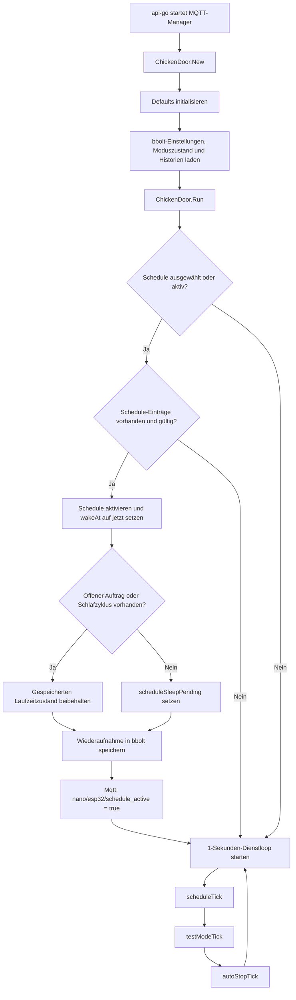
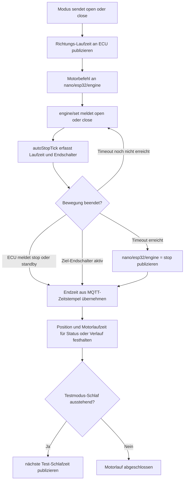

# ChickenDoor: Allgemeiner Ablauf

Diese Übersicht beschreibt den gemeinsamen Start-, Persistenz- und Motorlaufpfad. Die einzelnen Bedienmodi sind separat dokumentiert:

- [Manuelle Steuerung](CHICKENDOOR_FLOW_MANUAL.md)
- [Sleep-Schedule](CHICKENDOOR_FLOW_SCHEDULE.md)
- [Testmodus](CHICKENDOOR_FLOW_TEST_MODE.md)

## Start und gemeinsamer Dienst

Die Weboberfläche lädt Status und UI-State über die API. Dauerhafte Einstellungen werden per `PUT /api/huehnerklappe/ui-state` nach bbolt gespeichert. Der aktive Motorlauf wird beim Backend-Start aus dem aktuellen MQTT-Zustand rekonstruiert, nicht aus bbolt geladen. Ein Wechsel zum Schedule-Tab aktiviert den Schedule im laufenden Betrieb nicht; eine gespeicherte Schedule-Auswahl mit gültigen Einträgen wird beim Backend-Neustart wieder aufgenommen.

## Gemeinsamer Motorlauf und Auto-Stop

Manuelle Steuerung, Schedule und Testmodus verwenden denselben Motorlauf-Tracker. Bei Öffnen oder Schließen publiziert das Backend zunächst die Richtungs-Laufzeit und dann den Befehl an `nano/esp32/engine`. Der Backend-Tick verfolgt den ECU-Zustand über `nano/esp32/engine/set` und die Endschalter.

Der Timeout verwendet den kleineren Wert aus der richtungsabhängigen Auto-Stop-Zeit und dem gemeinsamen `engineMaxRuntimeSeconds`-Limit. `engine/status` ist MQTT-Subscription-Health, nicht die Motorposition. Endlage und Motorbewegung werden aus `engine/set` und den Endschalter-Themen abgeleitet.