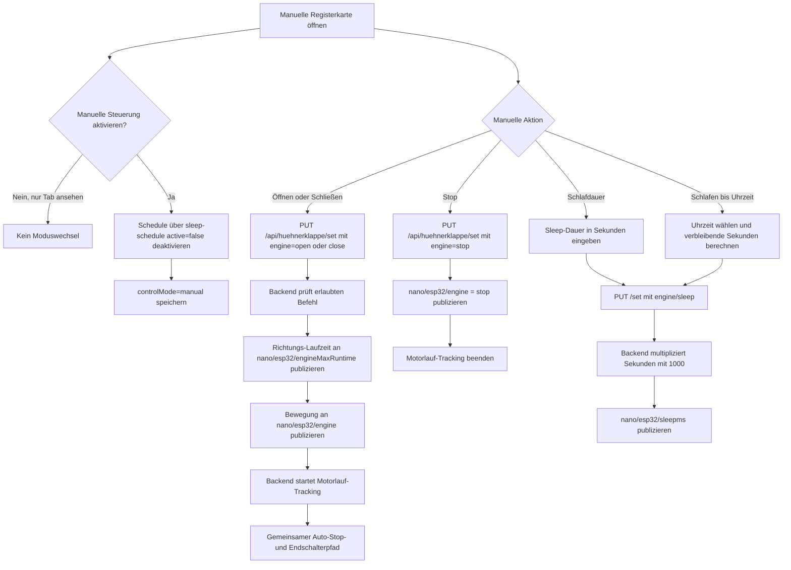

# ChickenDoor: Manuelle Steuerung

Die manuelle Ansicht bietet Öffnen, Schließen, Stop sowie Schlafen für eine Dauer oder bis zu einer Uhrzeit.

Die Registerkarte allein aktiviert den manuellen Modus nicht. Dafür ist die Schaltfläche „Manuelle Steuerung aktivieren“ erforderlich; sie deaktiviert den Schedule explizit. Der gemeinsame Motorlauf-/Auto-Stop-Pfad ist in der [allgemeinen Übersicht](CHICKENDOOR_FLOW_GENERAL.md) beschrieben.