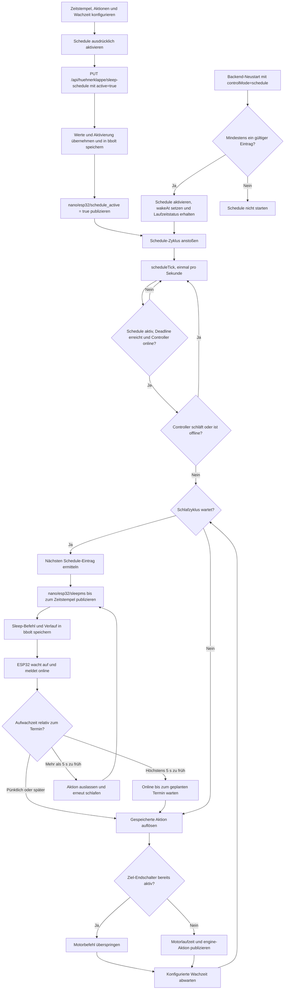

# ChickenDoor: Sleep-Schedule

Der Schedule schläft bis zum nächsten konfigurierten Zeitstempel, wertet den Aufwachzeitpunkt aus und führt die hinterlegte Aktion aus.

Die Schedule-Aktivierung bleibt explizit: Ein Tab-Wechsel allein aktiviert sie nicht. Beim Neustart wird eine gespeicherte Schedule-Auswahl mit gültigen Einträgen wieder aufgenommen. Das ECU-Gesundheitsthema `engine/status` ist nicht die Motorposition; Bewegung wird über `engine/set`, die Position über die Endschalter erkannt. Der Verlauf enthält maximal 20 Einträge.

Der gemeinsame Motorlauf-/Auto-Stop-Pfad ist in der [allgemeinen Übersicht](CHICKENDOOR_FLOW_GENERAL.md) beschrieben.