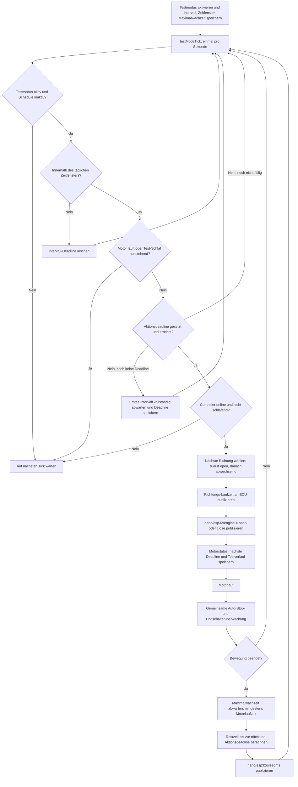

# ChickenDoor: Testmodus

Der Testmodus führt innerhalb des täglichen Zeitfensters in einem einstellbaren Intervall abwechselnd Öffnen und Schließen aus. Ein aktiver Timestamp-Schedule pausiert den Testmodus.

Ist die Aktionsdeadline erreicht, während der Controller nicht verfügbar ist, bleibt der Auftrag fällig und kann nach der Wiederverbindung einmal ausgeführt werden. Die Maximalwachzeit verlängert das Aktionsintervall nicht: Der Schlaf deckt nur die verbleibende Zeit bis zur nächsten Deadline ab; mindestens eine Sekunde Schlaf bleibt bestehen.

Der Testmodus setzt oder publiziert nicht `nano/esp32/schedule_active`. Die gemeinsame Motorlauf-/Auto-Stop-Logik ist in der [allgemeinen Übersicht](CHICKENDOOR_FLOW_GENERAL.md) beschrieben.